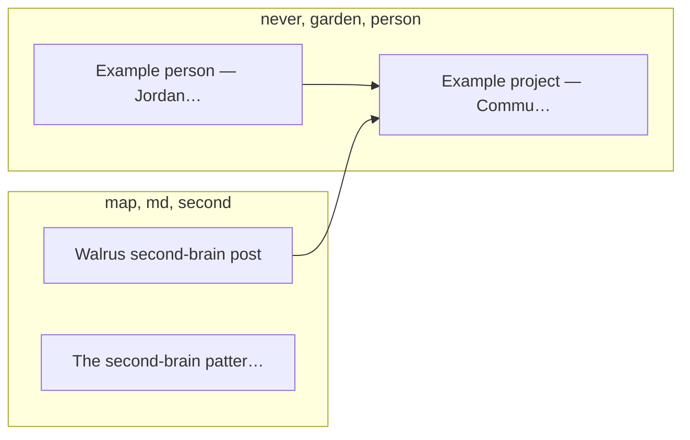

# ◈ MEMORY-MAP — the full memory map of the brain

_Generated by `scripts/memory-map.py` on 2026-11-09 03:43 UTC. Do not edit by hand — re-run `python3 scripts/memory-map.py`._

> **How to read this map.** Every node is a real note; every edge is a real `[[wiki-link]]`; every colour is a real ML topic cluster. Big nodes are hubs — the notes everything else hangs off. Dashed, quiet notes have no links yet: invitations, not errors. Start with the hubs, then follow a cluster.

## At a glance

| Notes | Links | Clusters | Hubs | Quiet notes | Duplicates |
| ---: | ---: | ---: | ---: | ---: | ---: |
| **3** | **4** | **2** | **3** | **0** | **0** |

- Files mapped: **35** (3 notes, 1 wiki page)
- Wikilinks: **4** (4 resolved, 0 broken)
- Link suggestions (ML): **1**
- Possible tensions (heuristic): **0**
- Stale candidates (unchanged 90+ days): **0**
- Pages marked `[source needed]`: **6**
- Notes/wiki/memory pages with no source line: **3**

## Hubs — the most-connected notes

| Note | Links | Degree |
| --- | ---: | --- |
| `[[example-project]]` | 3 | ███ |
| `[[example-person]]` | 2 | ██ |
| `[[walrus-second-brain-post]]` | 2 | ██ |

_Read a hub first when you come back to the brain — it re-orients you faster than any index._

## Clusters — where the brain actually lives

### 1. ● **never, garden, person** — 2 notes

`██` 2/3 notes

`[[example-person]]`, `[[example-project]]`

### 2. ● **map, md, second** — 2 notes

`██` 2/3 notes

`[[walrus-second-brain-post]]`, `[[second-brain-pattern]]`

## The map — as a diagram

Rendered by GitHub from the real links below. Every node is a note; every edge is a `[[wiki-link]]`.

_2 of 2 links shown — intra-cluster links and links touching a hub. The full list is in **Every file** below._

## Link suggestions — unlinked pairs worth linking

- 0.23 `[[walrus-second-brain-post]]` ↔ `[[second-brain-pattern]]` shared tags: brain

## Quiet notes — no links yet, invitations not errors

- None — every note is linked in.

## Every file — grouped by cluster

| File | Title | Tags | Out | In | Degree | Sources | Flags |
| --- | --- | --- | ---: | ---: | ---: | --- | --- |

### Cluster 1 — never, garden, person

| `notes/example-person.md` | Example person — Jordan Lee | #people | 1 | 1 | ██ 2 |  | no source line |
| `notes/example-project.md` | Example project — Community Garden Tracker | #ideas #projects | 1 | 2 | ███ 3 |  | no source line |

### Cluster 2 — map, md, second

| `notes/walrus-second-brain-post.md` | Walrus second-brain post | #brain #notes | 1 | 1 | ██ 2 | Walrus (@Walrus_systems), X post, Nov 7, 2026. |  |
| `wiki/second-brain-pattern.md` | The second-brain pattern this brain is built on | #brain | 0 | 0 |  0 |  | no source line |

### System files — the map's own machinery

| `daily/2026-11-08.md` | 2026-11-08 | #journal | 1 | 0 | █ 1 |  |  |
| `desk/README.md` | desk/ — working surface |  | 0 | 0 |  0 |  |  |
| `index.md` | Index — catalog of the wiki |  | 0 | 0 |  0 |  |  |
| `log.md` | Log — what happened, when |  | 0 | 0 |  0 |  |  |
| `memory.md` | Memory — durable facts |  | 0 | 0 |  0 | [where this came from, YYYY-MM-DD]. | source needed |
| `ml/__init__.py` | __init__ |  | 0 | 0 |  0 |  |  |
| `ml/embeddings.py` | embeddings |  | 0 | 0 |  0 |  |  |
| `ml/search.py` | search |  | 1 | 0 | █ 1 |  |  |
| `raw/README.md` | raw/ — immutable sources |  | 0 | 0 |  0 |  |  |
| `MAP.md` | MAP — index of the brain | #brain #goals #ideas #journal #money #notes #people #places #projects | 0 | 0 |  0 |  |  |
| `MEMORY-MAP.md` | ◈ MEMORY-MAP — the full memory map of the brain | #brain #goals #ideas #journal #money #notes #people #places #projects #tag1 #tag2 | 0 | 0 |  0 |  | source needed |
| `MUSE.md` | Muse Brain — MUSE.md, the map of the brain | #brain #goals #ideas #journal #money #notes #people #places #projects | 0 | 0 |  0 |  | source needed |
| `README.md` | Muse Brain — template | #brain #goals #ideas #journal #money #notes #people #places #projects | 0 | 0 |  0 |  |  |
| `rules/people.md` | People rules |  | 0 | 0 |  0 |  |  |
| `rules/writing.md` | Writing rules |  | 0 | 0 |  0 |  |  |
| `scripts/dup-check.py` | dup-check |  | 0 | 0 |  0 |  |  |
| `scripts/memory-map.py` | area -> (label, glob pattern, recursive?) |  | 4 | 0 | ████ 4 |  | source needed |
| `scripts/package.py` | package |  | 0 | 0 |  0 |  |  |
| `skills/ask/SKILL.md` | Ask |  | 0 | 0 |  0 |  |  |
| `skills/commit/SKILL.md` | Commit |  | 0 | 0 |  0 |  |  |
| `skills/ingest/SKILL.md` | Ingest |  | 0 | 0 |  0 |  | source needed |
| `skills/learn/SKILL.md` | Learn |  | 0 | 0 |  0 |  |  |
| `skills/lint/SKILL.md` | Lint |  | 0 | 0 |  0 |  | source needed |
| `skills/ml-search/SKILL.md` | ML search |  | 0 | 0 |  0 |  |  |
| `skills/rewrite/SKILL.md` | Rewrite |  | 0 | 0 |  0 |  |  |
| `skills/search/SKILL.md` | Search |  | 0 | 0 |  0 |  |  |
| `skills/weekly-review/SKILL.md` | Weekly review skill |  | 0 | 0 |  0 |  |  |
| `templates/atomic-note.md` | <Title — one topic> | #tag1 #tag2 | 0 | 0 |  0 |  |  |
| `templates/daily.md` | YYYY-MM-DD | #journal | 0 | 0 |  0 |  |  |
| `templates/person.md` | <First name> | #people | 0 | 0 |  0 |  |  |
| `templates/project.md` | <Project name> | #projects | 0 | 0 |  0 |  |  |

## Source gaps

- `MEMORY-MAP.md` — marked `[source needed]`
- `MUSE.md` — marked `[source needed]`
- `memory.md` — marked `[source needed]`
- `scripts/memory-map.py` — marked `[source needed]`
- `skills/ingest/SKILL.md` — marked `[source needed]`
- `skills/lint/SKILL.md` — marked `[source needed]`
- `notes/example-person.md` — no source line found
- `notes/example-project.md` — no source line found
- `wiki/second-brain-pattern.md` — no source line found
